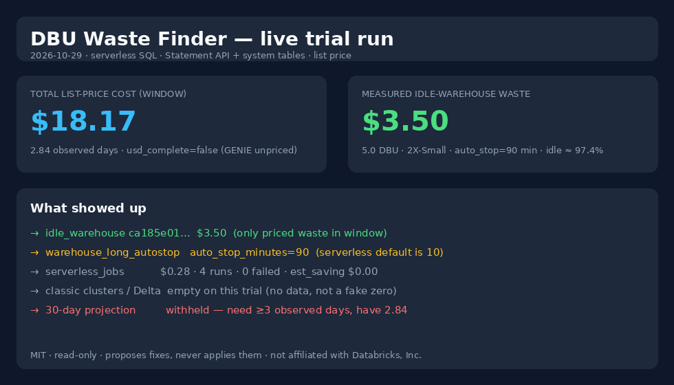

# DBU Waste Finder

A free, read-only Databricks notebook that shows where your DBUs go and which resources look wasteful, using only
Databricks **system tables**. One notebook, no install; the notebook sends nothing out of your workspace.

This repo contains two things:
- **`notebook/`** – the free notebook (below).
- **`mcp/`** – an MCP server so Claude/Cursor can answer "why did our bill jump?" from your system tables and propose fixes as a diff to your Asset Bundle (read-only, never applied). See [`mcp/README.md`](mcp/README.md).

Landing page: https://markatdataandbeyond.github.io/dbu-waste-finder/

## What it checks
| Check | Source tables |
|---|---|
| Cost by product and top 20 cost drivers (jobs, warehouses, clusters) at list price | `system.billing.usage` + `system.billing.list_prices` |
| Jobs running on all-purpose compute, with the list-price difference to job compute (ratio from the cluster's own billed SKU and cloud in `list_prices`; on a shared cluster only the share of billed time used by job runs counts, the full figure is shown as `est_saving_upper_bound_usd`) | `system.lakeflow.job_task_run_timeline` (`compute_ids`), `system.compute.clusters` |
| All-purpose clusters with auto-termination off (0/NULL) or above 60 min, incl. clusters deleted inside the window | `system.compute.clusters` (latest SCD row) |
| Idle or oversized clusters (avg CPU < 10 % and memory < 30 %) | `system.compute.node_timeline` |
| SQL warehouses with auto-stop off (0) or above 60 min, incl. warehouses deleted inside the window (`warehouse_long_autostop`) | `system.compute.warehouses` (latest SCD row) |
| Idle SQL warehouses: uptime (`cluster_count` × time between events) vs minutes with a query running; flagged at ≥ 80 % idle and ≥ 30 min up, waste in DBUs from size × list price of the warehouse's billed SKU (USD NULL until its usage is in billing) (`idle_warehouse`) | `system.compute.warehouse_events`, `system.query.history`, `system.compute.warehouses` |
| Serverless jobs: DBUs and cost per job, runs, failed runs; waste = failed-run share (`serverless_jobs`) | `system.billing.usage` (SKU contains `SERVERLESS`), `system.lakeflow.job_run_timeline` |
| Delta tables needing `OPTIMIZE` (many small files), `VACUUM` (stale/missing), or over-frequent manual `OPTIMIZE` (proposals only; never executed) | `system.storage.predictive_optimization_operations_history`, `system.query.history` |
| Measured waste and 30-day projection | see *How the projection works* below |

If a SKU has no row in `system.billing.list_prices` (e.g. `GENIE_FREE_USAGE`), USD totals are the sum of the **priced** part,
flagged incomplete (`usd_complete = false`), and the unpriced SKUs/items are listed (`unpriced_skus`, `unpriced()` in the notebook,
`unpriced_items` in `find_waste`). DBUs are always shown.

## Use
1. Import `notebook/dbu_waste_finder.py` into your workspace (File → Import).
2. Attach to any compute (serverless works) as a user with `USE CATALOG` on `system` and `USE SCHEMA` + `SELECT` on `system.billing`, `system.compute`, `system.lakeflow`, `system.query` (grant snippet in [`mcp/README.md`](mcp/README.md)).
3. Adjust thresholds in the first cell, Run all. Checks whose schema isn't enabled are skipped.

## How the projection works
- `measured_saving_usd` / `measured_waste_dbu`: the waste the checks found **inside the analysis window** (USD = priced items only).
- `observation_days`: how much data the window actually covers — from the earliest record inside the lookback window in
  `system.billing.usage` (`usage_start_time`) or `system.compute.warehouse_events` (`event_time`) until now, capped at the lookback.
  A workspace created yesterday has ~1 observed day even with a 30-day lookback.
- `projected_30d_usd` / `projected_30d_dbu` = measured ÷ `observation_days` × 30, only when `observation_days` ≥ 3. Below 3 days
  (or unknown) they are null and `projection_withheld` says why, e.g. `"need >=3 days, have 0.23"`.
- `low_confidence: true` (plus a note) when `observation_days` < 7 (3–7 days: projection shown but flagged). Exactly 7 is not flagged.
- This is an extrapolation of past waste at list price, not a promise of what you will get back.


## Demo output (example data)

The snippet below is **example / fixture data**, not a live workspace. It was produced by running the MCP tools
(`cost_summary`, `top_cost_drivers`, `find_waste`, `propose_fix`) against the same mock system-table rows the
unit tests use.

```text
cost_summary(days=15)
  total_list_cost_usd: 1000.00  (JOBS 700 + ALL_PURPOSE 300; usd_complete=false, GENIE_FREE_USAGE unpriced)
  daily: 2026-10-01 → $33.30

top_cost_drivers(days=15)
  job etl-nightly          $500.00
  cluster c-shared-01      $300.00
  warehouse wh-sql-01      $120.00

find_waste(days=15)
  measured_saving_usd: 203.15   measured_waste_dbu: 4.5
  observation_days: 15.0        projected_30d_usd: 406.30
  jobs_on_all_purpose:  c-shared-01  (2 jobs, est. $165 if moved to job compute)
  missing_autotermination: c-adhoc-02  (auto_termination_minutes=0)
  idle_or_oversized:    c-idle-03   (CPU 4 %, mem 12 %, est. $35)
  idle_warehouse:       wh-sql-01   (98.4 % idle, 4.0 DBU → $2.80)
  delta_needs_optimize: main.bronze.events  (500 files, ~4 MiB avg)
  delta_needs_vacuum:   main.bronze.events  (40 days since vacuum, ~3 GiB reclaimable)
  delta_overfrequent_optimize: main.silver.orders  (14 OPTIMIZE runs / 7 days)

propose_fix(issue="delta_optimize", resource_key="main.bronze.events")
  -- Proposal only; review before running. DBU Waste Finder never executes this.
  OPTIMIZE main.bronze.events;
```

## Live trial run (real workspace, 2026-10-29)

Not fixture data. Same tools (`cost_summary`, `top_cost_drivers`, `find_waste`, `cost_review_report`) against a Databricks **trial** workspace over serverless SQL (Statement API + system tables only).



| Field | Value |
|---|---|
| Observed days | **2.84** (30-day lookback requested) |
| Total list-price cost | **$18.17** (`usd_complete: false` — `GENIE_FREE_USAGE` 0.326 DBU unpriced) |
| Measured waste | **$3.50** / 5.0 DBU (`idle_warehouse` on a 2X-Small with `auto_stop_minutes=90`, idle ≈ 97.4 %) |
| 30-day projection | **withheld** (needs ≥ 3 observed days) |
| Classic clusters / Delta | empty on this trial — checks ran, no data |

Honesty: trial workspace, little real usage, list price not a negotiated discount. Full markdown/PDF of this run lives in the local `waste-test/` folder used for TDD; the image above is the executive summary only.

## Privacy
- **Notebook:** runs inside your workspace, read-only; nothing leaves the workspace.
- **MCP server:** the MCP server runs on your machine, not in the workspace. It reads system tables with your token and returns the
  results to your AI client (Claude, Cursor, …) and thereby to that AI provider: job/cluster/warehouse names and ids, DBUs,
  list-price amounts and owners' email addresses (`missing_autotermination` returns `owned_by`). Use a read-only service principal
  and only connect it to an AI client you may share that metadata with. Nothing is sent to Data and Beyond.

## Caveats
- Costs use `pricing.effective_list.default` (list price), not your contracted discount.
- For idle/oversized clusters, 50 % of their cost is counted as waste (an assumption; tune `IDLE_SAVING_SHARE`). Checks can overlap.
- Idle-warehouse DBU/h per size (2X-Small 4 … 4X-Large 528) is the published Databricks SQL rate, an assumption; real billed DBUs are in `system.billing.usage`.
- `system.billing.usage` lags by hours; `system.compute` and `system.query` usually land sooner, so warehouse checks can show results before cost does.
- `usage_metadata.job_id` is not populated for jobs on all-purpose compute (per Databricks docs), so those are detected via `job_task_run_timeline.compute_ids`.
- `system.billing` is account-wide, but `system.compute` and `system.lakeflow` only cover workspaces in the current region. Cluster usage billed in workspaces that this region can't see is listed under `cluster_region_gap` with a warning. Run the checks once per region.

## Sources (fetched 2026-10-26)
- Billable usage: https://docs.databricks.com/aws/en/admin/system-tables/billing
- Pricing: https://docs.databricks.com/aws/en/admin/system-tables/pricing
- Compute: https://docs.databricks.com/aws/en/admin/system-tables/compute
- Jobs: https://docs.databricks.com/aws/en/admin/system-tables/jobs

## Test locally
From the repo root (Python ≥ 3.10):
```bash
python3 -m venv .venv && .venv/bin/pip install -r requirements-test.txt -e ./mcp && .venv/bin/pytest -q
```
Runs the notebook test (every query parsed as Databricks SQL with sqlglot and executed on mock system tables in DuckDB),
the MCP server tests (mocked query results) and landing-page checks. No workspace needed.

## Validation status
- Run live against a Databricks trial workspace (AWS, serverless-only) on 2026-10-26: all queries execute; `idle_warehouse`
  found the test warehouse (77 min up, 2 busy min); `warehouse_long_autostop` found it after deletion; cost tools return DBUs
  and a partial USD total for priced SKUs ($6.89 at ~16:40Z) with `usd_complete: false` and the one unpriced SKU listed
  (`GENIE_FREE_USAGE`, 0.326 DBU).
- Not yet validated live: the classic-cluster checks (jobs on all-purpose, auto-termination, idle clusters) — the trial workspace
  cannot run classic clusters.
- Idle-warehouse USD verified live ~16:40Z: billed SKU PREMIUM_SERVERLESS_SQL_COMPUTE_US_WEST_OREGON at $0.70/DBU → 5.0 idle DBU = $3.50
  (billing: 3.88 DBU for 13:00–14:00Z, consistent with 4 DBU/h for 2X-Small).
- `serverless_jobs` verified live 2026-10-26 ~16:40Z: test job 4 runs / 0 failed (= `job_run_timeline`), 0.215 DBU and $0.08
  (= `system.billing.usage` 0.21454 DBU × $0.35). Billing then covered 13:00–14:00Z only (runs at 13:15 and 13:45Z), so the
  DBUs of the 14:15/14:45Z runs are not yet confirmed.

Not affiliated with Databricks. "Databricks" is a trademark of Databricks, Inc. MIT licensed, © 2026 Data and Beyond ApS.
